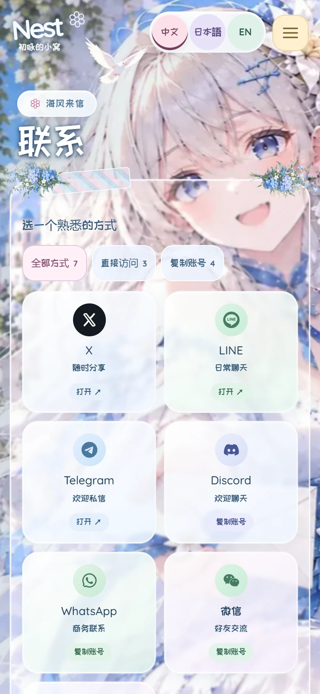

# 初咏的小窝 · My Little Nest

初咏的个人主页，用来放日常动态、随笔和联系方式，支持中 / 日 / 英三语切换。

在线访问：**[loveyong07.top](https://loveyong07.top)**


## 页面预览

| 动态页 (`/posts`) | 联系页 (`/contact`) |
| :---: | :---: |
|  |  |

| 首页（移动端） | 动态页（移动端） | 联系页（移动端） |
| :---: | :---: | :---: |
|  |  |  |

动态页截图使用示例数据。

## 做了什么

- **首页 (`/`)**：以头像与「初咏」为主视觉的手帐名片卡片搭配「小窝手记」卡片，桌面端一屏适配，同步展示最新的 X 头像与资料；左下角带「投喂」入口，右下角带网站源码与法律页面入口。
- **全站投喂弹窗**：首页、动态、联系、隐私政策与服务条款页左下角统一提供 `★ 投喂` 按钮，打开后展示半透明弹窗（含 `WeChat Pay`、`Alipay`、`BNB USDT` 与 `BNB USDC` 四个二维码及钱包地址一键复制），上方配图支持点击自适应放大预览（桌面与移动端均适配）。
- **按访客 IP 自动匹配语言**：首次访问通过服务端 `/api/visitor-language` 读取边缘地区头（`CN/HK/MO/TW` 默认中文、`JP` 默认日文，其余地区默认英文），访客手动切换语言后优先保留个人选择。
- **动态 (`/posts`)**：按置顶帖、原创动态、我的转帖、X 文章四个区域分开阅读；支持 `/` 搜索、站内分享直达、全量图片轮播灯箱、视频/GIF 播放，以及调用浏览器原生接口的卡片内翻译。
- **联系 (`/contact`)** 提供邮箱写信草稿、六种社交联系方式和免登录的[匿名留言入口](https://loveyong07.top/contact#anonymous-message)。「分享小窝」可以一键复制主页或匿名留言链接。
- **说明页 (`/privacy` · `/terms`)** 是独立静态三语页面，正文采用透出背景插画的玻璃面板，无 JS 环境也能直接阅读。
- **同源同步与媒体代理**：通过 Vercel 定时任务把 X 动态快照、原图 WebP（Vercel Blob）与视频归档（Google Drive）缓存到服务端，再经签名同源接口分发，方便直连访问。

桌面端可从动态页和联系页标题上方的「首页 / 动态 / 联系」导航切换，手机端使用右上角菜单。

## 技术栈

- **前端**：React 19、Vite 8、原生分包 CSS、自托管字体
- **后端与部署**：Node.js 24、Vercel Functions & Schedules（`hkg1`）、Vercel Blob、Google Drive API、`sharp`
- **检查与测试**：ESLint、Biome、TypeScript (`checkJs`)、Prettier、`node:test`、Playwright

## 本地运行

需要 **Node.js 24**。

```bash
npm ci
cp .env.example .env.local
npm run dev
```

不配置 `.env.local` 也可以直接运行并预览页面（动态页会回退到内置快照）。需要对接真实 X / Blob / Drive 同步或 StarryGal 中继时，可按 [.env.example](.env.example) 填入对应服务端环境变量（切勿加 `VITE_` 前缀）。

匿名留言通过独立 Vercel 留言项目和 Resend 投递到站主的 Gmail。发信前需验证发信域名，并在留言项目的生产环境配置 `RESEND_API_KEY` 和 `ANONYMOUS_MESSAGE_FROM`。未配置时，表单会提示暂不可用。 [匿名留言接入说明](docs/maintenance.md#联系页匿名留言)

## 常用命令

```bash
npm run dev           # 启动本地开发服务
npm run build         # 生产构建（输出到 dist/client）
npm run check         # Lint、类型检查、格式检查、单元测试与构建产物检查
npm run test:browser  # 浏览器交互与文章配图回归检查（需本机安装 Chrome/Edge）
```

更细的接口缓存、签名与媒体归档维护笔记见 [docs/maintenance.md](docs/maintenance.md)。
