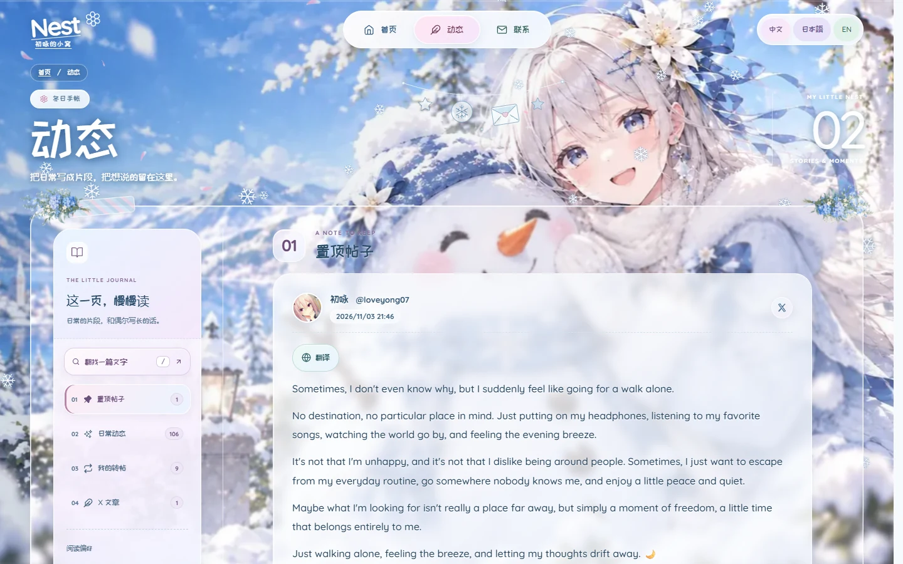
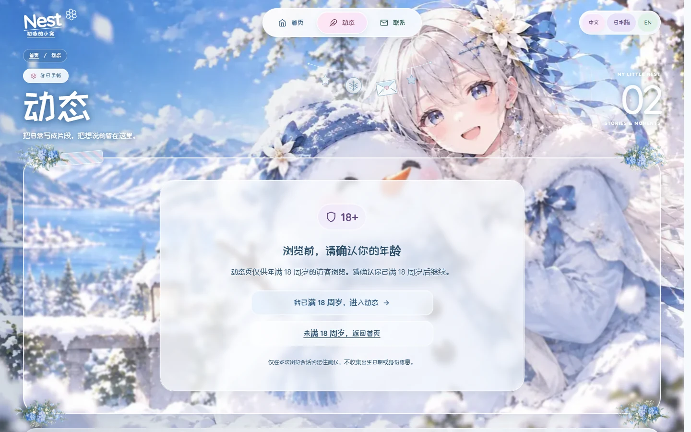
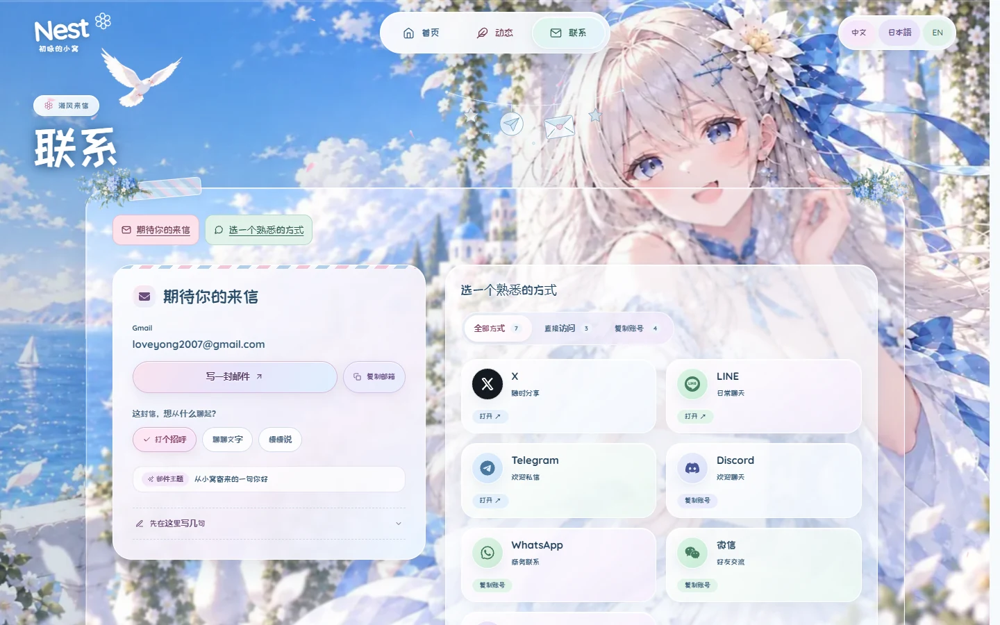
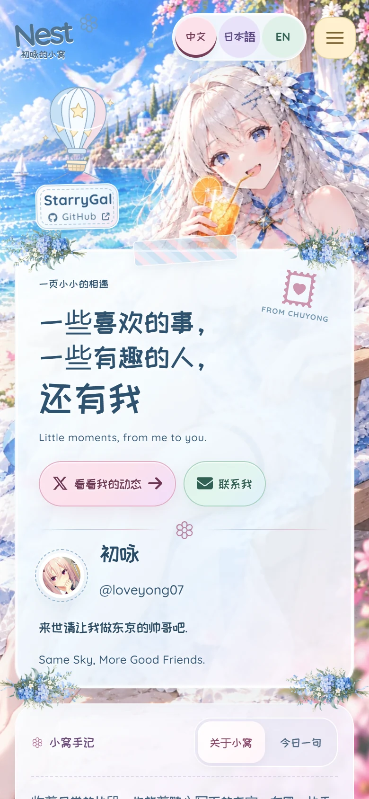
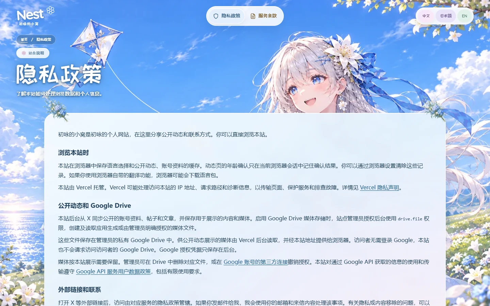
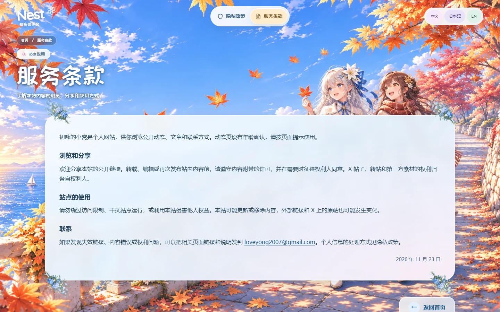
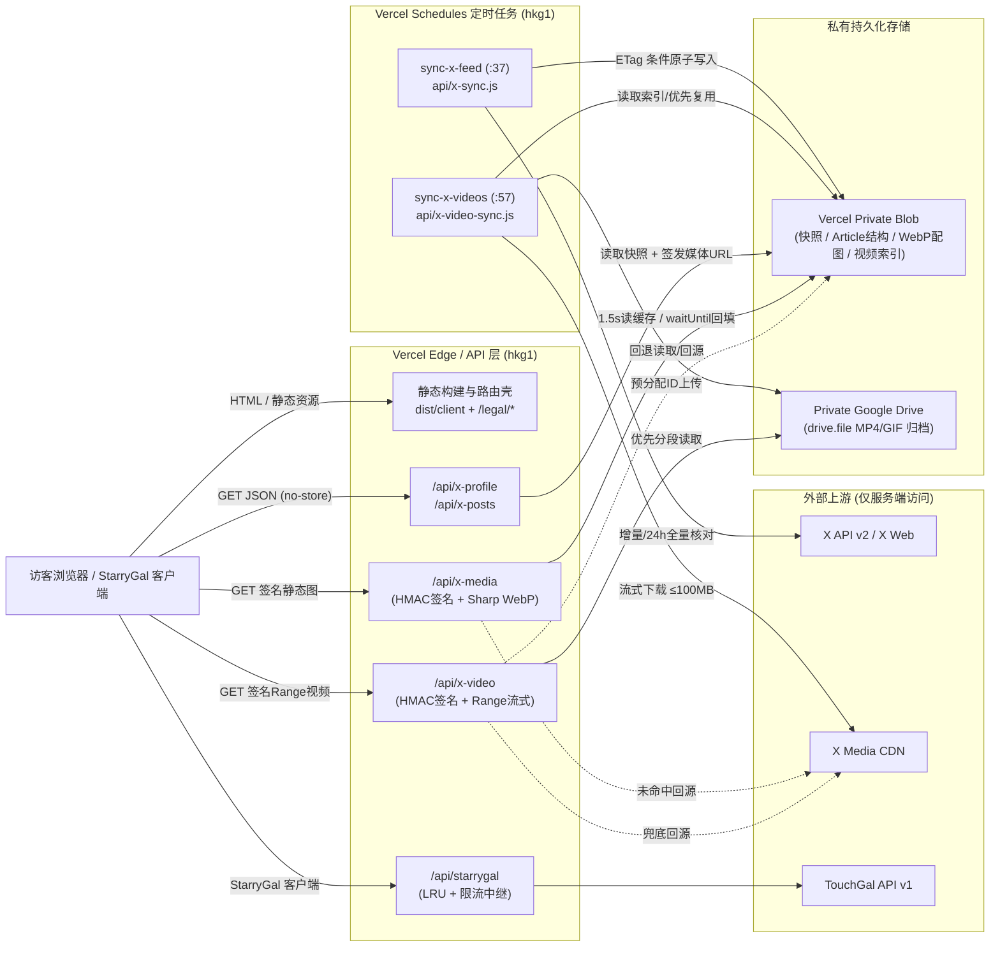

<div align="center">

# 初咏的小窝 · My Little Nest

**一个以手帐信笺与通透玻璃为视觉语言的个人网站，支持中 / 日 / 英三语、实时 X 动态归档阅读、同源媒体转码与端侧浏览器翻译。**

[在线访问 loveyong07.top](https://loveyong07.top) · [界面预览](#界面预览) · [核心功能](#核心功能) · [技术栈](#技术栈) · [系统架构与接口](#系统架构与接口) · [本地开发](#本地开发) · [部署说明](#部署说明)

<br />


</div>

---

## 项目简介

**初咏的小窝（My Little Nest）** 是基于 **React 19 + Vite 8 + Vercel Serverless Functions** 构建的个人社交名片与内容归档站点。站点围绕「晴空海滨 · 冬日手帐 · 海风来信 · 春鸢秋枫」主题插画与分层玻璃拟态设计，包含 **首页**、**动态**、**联系** 三个主路由以及独立静态的 **隐私政策**、**服务条款** 页面，提供 **简体中文 / 日本語 / English** 完整三语体验。

针对国内直连访问与长期可用性，站点在服务端实现了基于 **Vercel Schedules + 私有 Vercel Blob + 私有 Google Drive** 的定时快照与媒体持久化体系：所有 X 账号资料、原创帖、转帖、X 文章正文结构、原尺寸 WebP 配图以及 MP4/GIF 视频均通过 **HMAC 签名同源代理** 安全分发，并针对 Vercel 与 Sites 双宿主保持一致的安全响应头与路由策略。

---

## 界面预览

### 桌面端核心页面（1440 × 900）

| 页面 | 截图预览 | 视觉与交互亮点 |
| :--- | :---: | :--- |
| **首页** (`/`) |  | 晴空海滨固定视口背景、一屏自适应信笺与手记卡片、实时同步 X 头像/简介、四角蓝花饰与自适应空隙飞行的 `StarryGal` 热气球入口 |
| **动态页** (`/posts`) |  | 冬日雪景手帐、左侧阅读目录与 `/` 搜索抽屉、置顶 / 原创 / 转帖 / X 文章独立阅读流、内联浏览器翻译按钮与全量媒体轮播灯箱 |
| **年龄确认** (`/posts`) |  | 动态页入口 18+ 会话级确认屏障（仅保存于 `sessionStorage`、不收集身份信息，页面声明 `noindex, follow`） |
| **联系页** (`/contact`) |  | 海风来信双栏书桌：左侧为 `loveyong2007@gmail.com` 写信引导、主题模板与草稿箱；右侧为 7 大社交渠道分类筛选与一键复制 |

### 移动端响应式适配（390 × 844）

站点在 `≤ 900px` 或触控设备上自动切换紧凑布局、折叠式抽屉导航（保留 `≥ 44px` 触控目标）、原生手势滑动与长文「返回目录」按钮：

| 首页（移动端） | 动态页（移动端） | 联系页（移动端） |
| :---: | :---: | :---: |
|  |  |  |

### 独立静态法律页面（`/privacy` · `/terms`）

无需运行主 React 应用即可直接加载的纯静态三语说明页，分别配以春日风筝与秋日红叶主题插画，详细说明本地存储、Vercel 托管及后台 Google Drive `drive.file` 媒体归档边界：

| 隐私政策 (`/privacy`) | 服务条款 (`/terms`) |
| :---: | :---: |
|  |  |

---

## 核心功能

### 1. 首页与全局视觉体验
- **三语完整切换**：支持中文、日文、英文界面与独立本地化文案，自动记忆访客语言选择；法律页通过 URL Hash 同步语言状态。
- **玻璃拟态与季节场景**：采用通透分层玻璃材质与四角蓝花饰，配合 Canvas 粒子氛围、独立前景飞鸽/花瓣动效及高 DPI 分辨率约束；桌面精细指针视口（`> 900px`）启用一屏自适应（`--home-fit`），短窗口（`≤ 650px`）自动并排信笺与手记保持字号可读。
- **小窝手记与浮标**：内置「关于小窝」与「今日一句」轮换卡片、实时访问日期便签，以及避让文字区域的 `StarryGal` GitHub 仓库热气球入口。
- **无障碍与减少动画**：完整支持键盘焦点管理、跳转正文、强制高对比度模式（`forced-colors`）与系统 `prefers-reduced-motion` 偏好。

### 2. 动态页（X 内容归档与阅读器）
- **四大独立分区**：
  1. **置顶帖子**：固定展示当前 X 置顶帖并与日常流去重（若置顶为 X 文章则自动归入文章区）。
  2. **日常动态 · X 原创帖**：展示全量原创时间线与经账号验证的自引帖，支持月份筛选、日期索引条及桌面端 `←` / `→` 快捷键切换。
  3. **我的转帖**：展开真实 `retweeted` 引用与原作者/媒体数据，拥有独立的转发时间索引与切换状态（自动过滤回复与引用他人帖）。
  4. **随心分享 · X 文章**：按真实文章文档结构（`blocks`）保留每一张内嵌配图的原始段落位置、分隔线及命名/Markdown 链接，不扁平化、不限制配图数量。
- **全量媒体与独立播放状态**：
  - 静态配图统一请求 X `name=orig` 原始像素，经同源签名 `/api/x-media` 转码为无缩放 WebP（quality 90），支持任意数量（如 20 图）横向轮播条、桌面箭头/拖拽、触控原生滑动及全屏灯箱预览。
  - 所有视频与 `animated_gif` 经同源 `/api/x-video` 支持 HTTP Byte-Range 流式传输，每个附件独立重试、放大预览，并在打开/关闭灯箱时无缝保留播放进度、静音与播放/暂停状态；GIF 自动播放遵循系统减少动画偏好。
- **阅读目录、搜索与直达分享**：
  - 左侧阅读目录与「翻找一篇文字」搜索抽屉（快捷键 `/`），支持按正文、标题、ISO 日期、本地化日期及全角字符实时检索全部原创、转帖与文章，并提供「大字阅读」开关。
  - 帖子卡片「分享」生成同域直达链接（`/posts?post=<ID>` 或 `/posts?repost=<ID>`），完成年龄确认后自动聚焦并定位到对应卡片。
- **零密钥浏览器端侧翻译**：
  - 直接调用访客当前浏览器开放的 `LanguageDetector` 与 `Translator` API，无需任何外部翻译服务或 API 密钥。
  - 翻译目标自动跟随 `navigator.languages`（保留简繁中文区分，独立于站点 UI 语言），点击后才按需下载语言包并显示进度与取消按钮。
  - 完整保留原文切换、内联链接、Article 图文排版位置以及 Unicode `#话题标签` / 全角 `＃话题标签` 原文；未开放内置接口的浏览器提示使用浏览器菜单翻译作为后备。

### 3. 联系页与附加服务
- **写信引导与草稿箱**：唯一联系邮箱 `loveyong2007@gmail.com`，内置话题预设、开场白模板与站内草稿，可一键唤起 `mailto:` 或复制邮箱（剪贴板受限时自动展示手动复制框）。
- **多平台社交名片**：集成 X、LINE、Telegram、Discord、WhatsApp、微信、QQ 七大渠道，支持按「全部方式 / 直接访问 / 复制账号」筛选。
- **StarryGal 元数据中继（`/api/starrygal`）**：为桌面启动器 StarryGal 提供只读 TouchGal 元数据代理（搜索、详情、资源、补丁与状态检查），严格校验参数、隔离密钥并内置 LRU 缓存与单实例限流。

---

## 技术栈

### 前端层

| 类别 | 技术 / 工具 | 版本 | 用途说明 |
| :--- | :--- | :--- | :--- |
| **UI 框架** | React / React DOM | `19.3.1` | 组件化页面、路由懒加载（`lazy` + `Suspense`）与错误边界 |
| **构建工具** | Vite (Rolldown) + `@vitejs/plugin-react` | `8.3.8` / `6.3.0` | 极速开发与生产打包、自定义场景预加载插件（`build/scene-preloads.mjs`） |
| **样式系统** | 原生模块化 CSS（按路由拆包） | CSS3 / `@supports` | 首页公共样式 + 动态页/联系页按需 CSS 包、玻璃拟态与响应式断点 |
| **图标与字体** | `react-icons`、`@fontsource/quicksand`、`@fontsource/zcool-kuaile` | `5.7.0` / `5.3.0` | 全量自托管 WOFF/WOFF2 字体（兼容 `font-src 'self'` CSP），辅以 Python 字体子集化脚本 |
| **浏览器能力** | Web `Translator` / `LanguageDetector` API、Canvas 2D、ResizeObserver | 浏览器原生 | 零密钥端侧翻译、低开销预渲染粒子精灵与一屏精确测量 |

### 服务端与基础设施

| 类别 | 技术 / 工具 | 版本 / 区域 | 用途说明 |
| :--- | :--- | :--- | :--- |
| **运行环境** | Node.js (ESM) | `24.x` (`.nvmrc`) | 服务端函数、共享契约、构建脚本与 CI 一致运行环境 |
| **托管与边缘** | Vercel Functions & Vercel Schedules | 香港 `hkg1` | 无服务器 API 路由、流式视频转发、每小时定时同步与 CDN 边缘缓存 |
| **对象与媒体存储** | `@vercel/blob`、`@vercel/functions`、`@vercel/schedules` | `2.9.0` / `3.11.3` / `0.0.3` | 私有 X 动态快照、Article 文档缓存、800 MB 软预算配图缓存与 `waitUntil` 后台落盘 |
| **视频归档存储** | Google Drive API（OAuth `drive.file`） | 私有 Drive | 归档已发布快照中的视频与 GIF MP4（单文件上限 100 MB），支持同源 Range 分段读取 |
| **图像处理** | `sharp` | `0.35.5` | 将 X 原始静态配图无缩放实时转码为 quality 90 WebP，异常时安全回退原图 |
| **上游数据源** | X API v2、TouchGal Developer API | 仅服务端调用 | 账号资料、时间线/置顶/转帖/文章同步与 StarryGal 元数据中继 |
| **双宿主兼容** | Sites Worker (`worker/index.js`) + `shared/hosting-policy.mjs` | 同步构建 | 与 Vercel 共享安全头、路由壳、`/business` 308 重定向与 `/api/*` 处理逻辑 |

### 工程化、质量门禁与测试

| 类别 | 技术 / 工具 | 版本 | 用途说明 |
| :--- | :--- | :--- | :--- |
| **静态类型检查** | TypeScript (`checkJs`) | `5.9.3` | 无构建侵入式类型契约校验，覆盖全部 `src/`、`shared/`、`server/`、`api/` 与 `worker/` |
| **代码与 CSS 检查** | ESLint + `eslint-plugin-react-hooks`、Biome、`css-tree` | `10.15.0` / `2.6.7` / `3.2.1` | JS/React Hooks 零警告门禁、CSS 结构排错与 CSS AST 语法约定检查 |
| **代码格式化** | Prettier | `3.10.1` | 统一代码风格与格式校验（`format:check`） |
| **单元与产物测试** | `node:test` + JSDOM | Node 24 / `30.1.3` | 覆盖 API、签名认证、缓存策略、组件渲染、构建产物防泄露检查与 Sites Worker 测试 |
| **浏览器与视觉 QA** | `playwright-core` + `pixelmatch` + `pngjs` | `1.65.1` / `8.x` / `7.x` | 真实浏览器回归、文章图文顺序校验、安全冒烟与修改前后固定场景像素/样式比对 |
| **安全与供应链** | GitHub Actions CI、Dependabot、本地 `picomatch` 补丁 | 持续审计 | CI 凭据哨兵防泄露、`npm run audit:ci`（含 Zod `4.6.6` 与 `picomatch` 安全基线审计） |

---

## 系统架构与接口

### 数据同步与访问架构



### API 路由一览

| 路径 / 函数 | 类型 | 超时 / 区域 | 说明与缓存 / 安全策略 |
| :--- | :--- | :--- | :--- |
| `GET /api/x-profile` | 公开同源接口 | `30s` / `hkg1` | 返回账号资料并签发头像同源 URL；拒绝任意查询参数（400）；浏览器 `no-store`，CDN `s-maxage=300, swr=600`（异常 `60s`） |
| `GET /api/x-posts` | 公开同源接口 | `30s` / `hkg1` | 从共享快照返回置顶、原创、转帖与 X Articles 并按请求时间签名；整次服务端刷新预算 `24s`、浏览器超时 `27s` |
| `GET /api/x-media` | 签名媒体代理 | `60s` / `hkg1` | 校验 `Sec-Fetch-Site` 与 HMAC 签名（含双密钥轮换），支持 `format=webp`（Sharp q90 原尺寸转码）与私有 Blob 持久缓存（上限 `12 MiB`） |
| `GET /api/x-video` | 签名视频代理 | `60s` / `hkg1` | 签名校验后优先从私有 Google Drive 分段读取，回退 Blob / X CDN；支持单段 HTTP Byte-Range（`206 Partial Content`），单次上限 `55s` |
| `GET /api/starrygal` | 元数据中继 | `20s` / `hkg1` | 转发 TouchGal 公开只读接口（搜索、详情、资源、补丁、状态），严格白名单校验、12s 上游超时、2 MiB 上限与每分钟 30 次/实例限流 |
| `api/x-sync.js` | 私有定时任务 | `55s` / `hkg1` | Vercel Schedules `37 * * * *` 触发，基于 `since_id` 增量拉取并每 24 小时全量核对，原子写入私有 Blob 快照与 Article 文档缓存 |
| `api/x-video-sync.js` | 私有定时任务 | `60s` / `hkg1` | Vercel Schedules `57 * * * *` 触发，从已发布快照提取视频与 GIF MP4 归档至私有 Google Drive 并维护 Blob 预留/索引 |

### 安全、性能与 SEO 约定
- **双端一致安全头（`shared/hosting-policy.mjs`）**：Vercel 与 Sites 共用严格的 `Content-Security-Policy`（`default-src 'self'`、`script-src 'self'`、`font-src 'self'`、`frame-ancestors 'none'`）、`Strict-Transport-Security`、`X-Frame-Options: DENY`、`X-Content-Type-Options: nosniff`、`Referrer-Policy`、`Permissions-Policy` 与 `Cross-Origin-Opener-Policy: same-origin`。
- **同源防盗链与密文隔离**：媒体端点强制检查 Fetch Metadata（拒绝跨站与兄弟子域 `same-site`）并附带 `Vary: Sec-Fetch-Site` 与 `Cross-Origin-Resource-Policy: same-origin`；生产构建关闭 sourcemap，CI 注入凭据哨兵验证任何密钥都不会进入 `dist/client`。
- **缓存与预加载**：哈希构建资源设置 `immutable` 一年缓存，`/posts` 响应头注入主场景 WebP 高优先级 `Link` 预加载；动态正文特色字体与装饰粒子在主内容就绪后延迟加载。
- **路由壳与 SEO**：首页（`/`）与联系页（`/contact`）拥有独立的 canonical URL、Open Graph / Twitter Card（封面 `public/assets/og-cover.jpg`，1200×630）并收录于 `/sitemap.xml`；动态页（`/posts`）通过独立路由壳设置 `noindex, follow` 且不列入站点地图；`/api/` 在 `public/robots.txt` 与响应头 `X-Robots-Tag` 中双重禁止抓取；历史路径 `/business` 永久 `308` 重定向至 `/`。

> 更详尽的超时预算、缓存淘汰策略、签名轮换、Drive 故障诊断与依赖安全说明见 [接口与媒体维护说明](docs/maintenance.md)。

---

## 目录结构

```text
my-little-nest/
├── api/                        # Vercel Serverless Functions 与定时同步入口
├── build/                      # Vite 自定义构建插件（场景资源预加载）
├── docs/
│   ├── screenshots/            # README 展示用页面截图（不参与 Vercel 站点发布）
│   ├── maintenance.md          # X 接口、媒体签名、缓存、Drive 归档与依赖审计说明
│   ├── styles.md               # 分层 CSS 架构、断点对齐与修改前后视觉回归指南
│   └── history/                # 阶段性设计与验收历史记录
├── public/
│   ├── assets/                 # 实际发布的插画、WebP 场景图、图标与自托管字体
│   ├── legal/                  # 独立静态三语隐私政策（privacy.html）与服务条款（terms.html）
│   ├── robots.txt              # 爬虫抓取规则（禁止 /api/）
│   └── sitemap.xml             # 仅收录首页与联系页的站点地图
├── scripts/
│   ├── qa/                     # Playwright 交互回归、文章图文、安全冒烟与固定场景视觉采集器
│   ├── prepare-sites-build.mjs # 生成 Sites 兼容产物（dist/server、dist/.openai）
│   ├── sync-x-snapshot.mjs     # 首次/手动同步 X 动态快照到私有 Blob
│   ├── warm-photo-cache.mjs    # 首次预热静态配图 WebP 缓存到私有 Blob
│   ├── verify-drive-connection.mjs # 部署前校验 Google Drive OAuth 凭据与写权限
│   └── ...                     # CSS AST 校验、依赖审计与字体子集化脚本
├── server/                     # 共享 API 路由核心、X/Article/Drive/Blob/WebP/StarryGal 服务与遥测日志
├── shared/                     # 前后端共享的账号配置、数据契约、超时预算与双宿主安全策略
├── src/
│   ├── App.jsx                 # 应用入口、路由切换、懒加载与延迟装饰调度
│   ├── pages/                  # 动态页（PostsPage.jsx）与联系页（ContactPage.jsx）
│   ├── components/             # 首页信笺/手记、导航、帖子/转帖/文章卡片、灯箱、端侧翻译、粒子动效等
│   ├── constants/              # 中/日/英三语文案、联系方式、断点媒体查询与站点常量
│   ├── hooks/                  # 路由、三语、Feed/Profile 缓存、翻译、滑动切换、减少动画等 Hooks
│   ├── routes/                 # 路由路径映射、场景资源与动态 SEO 元数据同步
│   ├── styles/                 # 按基础/首页、动态页、联系页分层拆包的 CSS 模块
│   └── utils/                  # 日期格式化、阅读检索、分享定位、视频状态恢复与端侧翻译工具
├── tests/                      # Node 内置逻辑测试、JSDOM 组件测试、构建产物检查与 Sites 测试
├── types/                      # Ambient 与资源类型声明（供 checkJs 使用）
├── vendor/picomatch/           # 本地安全回补补丁包（修复 GHSA-fc5q-39xc-vjpf）
├── worker/ & .openai/          # Sites 运行时 Worker 与宿主配置
├── index.html                  # 主应用 HTML 模板与社交分享 Meta
├── vercel.json                 # Vercel 构建命令、hkg1 函数配置、定时任务、安全头与重写规则
├── vite.config.mjs             # Vite 8 构建与本地 API 中间件配置
└── AGENTS.md                   # 当前有效的内容、视觉设计与工程维护约定
```

> `qa/` 与 `.vercel/` 为本地忽略提交的临时验证与平台配置目录；`archive/` 仅保存原始素材与设计参考，不发布到线上站点。

---

## 本地开发

### 环境要求
- **Node.js 24.x**（与 `.nvmrc`、`package.json` 及 GitHub Actions CI 保持一致）
- 本地已安装 **Chrome** 或 **Microsoft Edge**（用于浏览器回归与视觉采集）

### 安装与启动

```powershell
# 1. 使用锁文件安装依赖
npm ci

# 2. 启动本地开发服务器（遵循系统网络代理，便于访问 X 上游）
npm run dev:proxy -- --host 127.0.0.1 --port 4173 --strictPort
```

启动后访问 [http://127.0.0.1:4173/](http://127.0.0.1:4173/)。在无需系统网络代理的环境可直接运行：

```powershell
npm run dev -- --host 127.0.0.1 --port 4173 --strictPort
```

### 环境变量配置

如需本地拉取实时 X 数据、操作 Blob 快照或调试 StarryGal 中继，可复制 `.env.example` 为 `.env.local` 按需配置。未配置时页面仍可正常运行，动态页自动保留本地快照与状态提示。

> **安全提醒**：以下变量**仅供服务端使用**，严禁提交到版本库，也严禁添加 `VITE_` 前缀。

| 环境变量 | 适用环境 | 说明 |
| :--- | :--- | :--- |
| `X_BEARER_TOKEN` | 本地 / 生产 | X API v2 Bearer Token，供定时同步函数与本地预览使用 |
| `X_MEDIA_SIGNING_SECRET` | 可选（推荐） | 独立的高熵媒体 URL 签名密钥；未设置时从 `X_BEARER_TOKEN` 派生 |
| `X_MEDIA_SIGNING_SECRET_PREVIOUS` | 可选 | 密钥轮换过渡期保留的旧签名密钥，确保旧链接平滑过期 |
| `BLOB_READ_WRITE_TOKEN` | 生产 / 脚本 | Vercel 私有 Blob 存储读写令牌，用于动态快照、文章结构与配图缓存 |
| `GOOGLE_DRIVE_CLIENT_ID` | 仅生产 | Google OAuth Web 客户端 ID（`drive.file` 权限） |
| `GOOGLE_DRIVE_CLIENT_SECRET` | 仅生产 | Google OAuth Web 客户端密钥 |
| `GOOGLE_DRIVE_REFRESH_TOKEN` | 仅生产 | Google OAuth 刷新令牌，用于定时归档与分段读取私有 Drive 视频 |
| `TOUCHGAL_API_TOKEN` | 本地 / 生产 | TouchGal Developer API 令牌，供 `/api/starrygal` 服务端中继使用 |

### 常用维护脚本（需配置对应服务端凭据）

```powershell
# 首次导入 / 手动同步 X 快照到私有 Blob
node --env-file=.env.local scripts/sync-x-snapshot.mjs

# 首次预热静态配图 WebP 缓存到私有 Blob（可加 --limit 3 仅试跑 3 张）
node --env-file=.env.local scripts/warm-photo-cache.mjs

# 校验 Google Drive OAuth 授权与文件 ID 预分配权限
node --env-file=.env.local scripts/verify-drive-connection.mjs
```

---

## 命令与质量门禁

### 核心 npm 脚本

| 命令 | 作用 |
| :--- | :--- |
| `npm run check` | **完整交付门禁**：依次运行 `lint` → `typecheck` → `format:check` → `test:unit` → `build` → `test:build` → `test:sites` |
| `npm run lint` | ESLint（零警告）+ Biome CSS 结构检查 + `css-tree` CSS 语法校验 |
| `npm run typecheck` | TypeScript `checkJs` 全量类型与共享契约检查 |
| `npm run format` / `format:check` | Prettier 自动格式化 / 格式一致性检查 |
| `npm test` / `npm run test:unit` | 运行 `tests/*.test.mjs` 单元测试（不依赖 `dist/`） |
| `npm run build` | 生成 `dist/client`、`dist/server` 与 `dist/.openai` 双宿主产物 |
| `npm run test:build` | 校验构建产物完整性、字体自托管、安全头一致与服务端密钥零泄露 |
| `npm run test:sites` | 验证 Sites Worker 路由、安全头、308 重定向与 API 兼容性 |
| `npm run audit:ci` | 覆盖生产与开发依赖的 `moderate` 级安全审计及本地 `picomatch` 补丁基线校验 |
| `npm run test:browser` | 构建后启动本地模拟环境校验日期搜索、缓存状态、真实短 MP4 播放进度、导航与文章图文顺序（不调用线上 X 接口） |
| `npm run preview` / `preview:proxy` | 本地预览生产构建结果 |

### 样式修改与专项浏览器验收

修改 CSS、布局或组件结构时，除 `npm run check` 外，还需使用固定场景采集器进行修改前后比对（详见 [样式维护说明](docs/styles.md)）：

```powershell
# 1. 基线构建并采集固定场景（含桌面、短屏、手机、三语与交互状态）
npm run build
npm run qa:styles -- capture qa/styles/before

# 2. 修改源码后重新构建并采集对比
npm run build
npm run qa:styles -- capture qa/styles/after
npm run qa:styles -- compare qa/styles/before qa/styles/after
```

其余专项脚本（构建后在本地模拟上游运行，不触及真实线上接口）：

```powershell
node scripts/qa/security-smoke.mjs   # 校验浏览器缓存、Fetch Metadata 来源拒绝与视频 Range 传输
node scripts/qa/article-images.mjs   # 校验文章图文顺序、桌面/手机灯箱放大与真实链接点击
node scripts/qa/reposts.mjs          # 校验转帖三语、响应式布局、独立阅读与搜索
```

---

## 部署说明

- **源码仓库**：[loveyong07/my-little-nest](https://github.com/loveyong07/my-little-nest)，生产分支为 `master`。
- **正式站点**：[https://loveyong07.top](https://loveyong07.top)。
- **自动部署**：完成 `npm run check` 后推送 `master`，自动触发 [Vercel 项目](https://vercel.com/fyh2026s-projects/my-little-nest) Production 构建：
  1. 首先执行 `node scripts/verify-drive-connection.mjs`，使用生产环境变量刷新 Drive OAuth 令牌并验证授权有效；
  2. 随后运行 `npm run build`，输出静态产物目录 `dist/client` 并按 `vercel.json` 部署 `hkg1` 无服务器函数与路由规则。
- **后台定时同步**：
  - `sync-x-feed`（`37 * * * *`）：每小时同步最新 X 资料、置顶、原创、转帖与文章到私有 Blob 快照。
  - `sync-x-videos`（`57 * * * *`）：每小时将已发布快照中的视频与 GIF MP4 归档到私有 Google Drive。
  - 两项任务均可在 Vercel 项目的 Schedules 面板随时手动触发。
- **双宿主兼容**：仓库保留 `.openai/`、`worker/` 与 `scripts/prepare-sites-build.mjs`，构建时自动剔除仅 Vercel 使用的存储模块，并与 Vercel 共用 `shared/hosting-policy.mjs` 保证安全头、路由壳与重定向规则完全一致。

---

## 延伸文档

- [docs/maintenance.md](docs/maintenance.md) — X 接口限流与退避、媒体签名与 WebP 缓存、Drive 视频归档、StarryGal 中继与依赖安全审计详解
- [docs/styles.md](docs/styles.md) — 样式分层加载顺序、响应式断点对齐与 `qa:styles` 视觉对比流程
- [docs/history/README.md](docs/history/README.md) — 历史迭代、安全加固与视觉验收记录索引
- [AGENTS.md](AGENTS.md) — 当前有效的内容规范、视觉设计与工程维护约定
